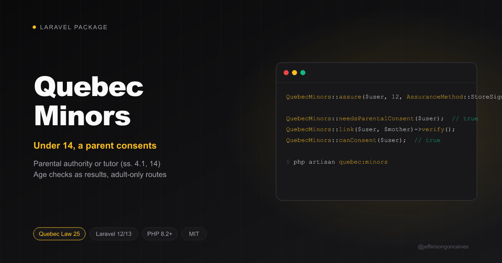

# Laravel Quebec Minors



[](https://packagist.org/packages/jeffersongoncalves/laravel-quebec-minors)
[](https://github.com/jeffersongoncalves/laravel-quebec-minors/actions/workflows/tests.yml)
[](https://packagist.org/packages/jeffersongoncalves/laravel-quebec-minors)

Minors' consent under Quebec's private sector privacy act (Law 25). It is part of the [laravel-quebec](https://github.com/jeffersongoncalves/laravel-quebec) suite.

Personal information concerning a minor under 14 may not be collected from them without the consent of the person having parental authority or the tutor, unless collecting it is clearly for the minor's benefit (s. 4.1). Consent for a minor under 14 is given by that person; from 14, the minor consents alone (s. 14).

- **Age checks as results only:** you store the age, the method and the provider. The document, selfie or birth date used to reach it is never stored (data minimisation). Results expire, so users are checked again over time.
- **One age per user:** reliable checks outweigh self-declaration, and the youngest reliable result wins.
- **Consent age 14:** configurable as `consent_age`.
- **Parental authorisation:** a verified guardian link. `canConsent()` tells you whether a consent given by this user counts.
- **No profiling for minors:** profiling technology is off by default (s. 8.1) and the highest confidentiality settings apply by default (s. 9.1). `allowsProfiling()` and `@quebecProfiling` only let verified adults through.
- **Adult-only routes:** the `quebec.adult` middleware requires a reliable adult result.

> This package gives you tooling. It does not make you compliant on its own. You still need legal review, for example to decide when a collection is clearly for the minor's benefit.

## Installation

```bash
composer require jeffersongoncalves/laravel-quebec-minors
php artisan vendor:publish --tag="quebec-minors-migrations"
php artisan migrate
php artisan vendor:publish --tag="quebec-minors-config"   # optional
```

## Usage

```php
use JeffersonGoncalves\QuebecMinors\Enums\AssuranceMethod;
use JeffersonGoncalves\QuebecMinors\Facades\QuebecMinors;

QuebecMinors::assure($user, 12, AssuranceMethod::StoreSignal);

QuebecMinors::age($user);                    // 12
QuebecMinors::consentAge();                  // 14
QuebecMinors::needsParentalConsent($user);   // true: under 14
```

Before you rely on a consent (for example with [laravel-quebec-consent](https://github.com/jeffersongoncalves/laravel-quebec-consent)):

```php
if (! QuebecMinors::canConsent($user)) {
    // ask a parent: send them a verification link, then link and verify them
}
```

The methods are `self_declaration`, `os_signal`, `store_signal`, `document`, `facial_estimation`, `verifiable_credential` and `guardian`. You choose which ones count as reliable in `reliable_methods`, and how long each one is valid in `valid_for`. The stored age is the age at the time of the check; the current age adds the whole years since then.

A user with no valid result has an unknown age. While `likely_access` is true (the default), unknown users are treated as minors: they need parental consent and get no profiling.

### Parental authorisation

```php
$link = QuebecMinors::link($minor, $parent, 'mother');   // pending
$link->verify();                                         // after your verification step

QuebecMinors::canConsent($minor);    // true
QuebecMinors::guardians($minor);     // Collection of parent models
$link->revoke();
```

### Profiling and adult content

```blade
@quebecProfiling
    <script src="https://ads.example.com/pixel.js"></script>
@endquebecProfiling
```

```php
Route::get('/adult', AdultController::class)->middleware(['auth', 'quebec.adult']);
```

Users without a reliable adult result get a 403. To send them to your age check instead, set `verify_route` to that route's name.

### Report

```bash
php artisan quebec:minors          # users under 14 without a verified parent or tutor
php artisan quebec:minors --json
```

The command exits with 1 when something needs attention.

## Testing

```bash
composer test
```

## Changelog

See [CHANGELOG](CHANGELOG.md).

## License

The MIT License (MIT). See [License File](LICENSE.md).
